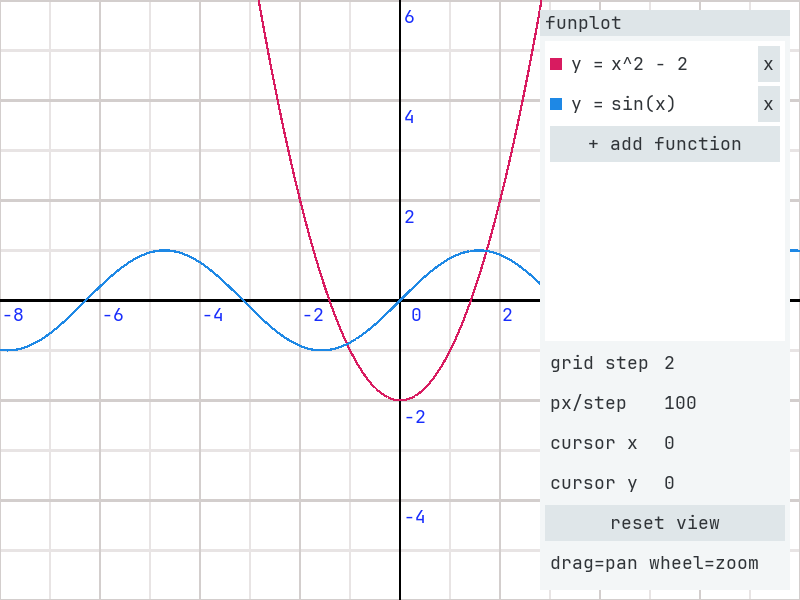
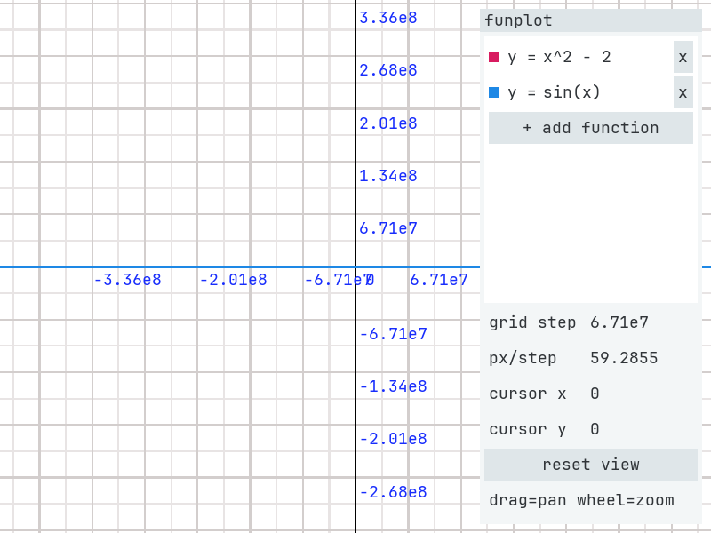

# funplo

a small, self-contained function plotter.

type in expressions like `x^2 - 2` or `sin(x)` in the side panel, plot as
many of them as you like in different colors, and zoom/pan around freely
while the grid and its numbers "just keep working" at any scale.



zoom way in or out and the grid re-labels itself, falling back to scientific
notation so numbers never clutter the axes:



## features

- **expressions, not formulas** — a tiny recursive-descent compiler turns your
  string into postfix ops and evaluates it cheaply at every sample
- **implicit multiplication** — `2x`, `xsin(x)`, `(x+1)(x+2)`... all just work
- **many functions at once** — each row gets its own color swatch and its own
  editable textbox; add/remove rows freely midsession
- **smooth curves** — the plot is sampled twice per pixel and drawn as GL line
  strips with 4x MSAA; poles & asymptotes (like `tan(x)`) cut the strip instead
  of drawing ugly vertical lines
- **zoom that stays readable** — wheel zooms (anchored at the cursor),
  dragging pans; the grid re-labels itself in integer jumps so labels always
  stay the same fixed size, and extreme values fall back to scientific
  notation (`3.36e8`, `7.81e-3`) so nothing ever clutters
- **friendly errors** — a mistyped expression (`xor(x)`) shows the reason in
  red under the row without breaking anything else
- **nice runtime-baked font** — glyphs are rasterized with FreeType from
  JetBrains Mono (with fallbacks) into one GL atlas at startup

## building

```sh
make
./main
```

requirements: SDL2 (+ OpenGL), FreeType, and a GPU that speaks roughly
OpenGL 1.1 fixed function. on debian-ish systems:

```sh
sudo apt install build-essential libsdl2-dev libfreetype-dev
```

## controls

| action        | input                     |
| ------------- | ------------------------- |
| type function | side panel textboxes      |
| zoom          | mouse wheel - in/out, anchored at the cursor |
| pan           | left click + drag in the plot |
| zoom out / reset view | `reset view` button |

## expressions

grammar, quick tour:

```
x^2 - 2        powers and precedence
sin(x)         call syntax
2x             implicit multiplication
xsin(x)        this too!
pi, tau, e     constants
%              modulo
```

builtins: `sin cos tan asin acos atan sinh cosh tanh sqrt abs exp ln log
log2 floor ceil min max pow mod atan2 hypot`

## project layout

```
main.c      window + opengl renderer + microui panel + test harness
expr.h      the little expression compiler (header-only)
plane.h     plane state: origin, zoom, grid renormalization (header-only)
microui.c/h [rxi/microui](https://github.com/rxi/microui) with a custom GL backend
desc_font.h embedded bitmap font, used if no system font can be found
```

## headless mode (dev & testing)

`main` is quietly scriptable so it can drive itself inside `xvfb-run`
without touching a real display:

```sh
xvfb-run -a env FUNPLO_SCRIPT=script FUNPLO_SHOT_DIR=shots ./main
```

one line per frame, each line is an action:

| line      | action                                       |
| --------- | -------------------------------------------- |
| `m x y`   | move mouse                                   |
| `p` / `u` | press / release button                       |
| `d x y`   | press at that spot (release with `u` later)  |
| `w n`     | `n` wheel ticks (negative = zoom out)        |
| `t text`  | type text into the focused textbox           |
| `n`       | wait a frame (lets clicks register)          |
| `S name`  | screenshot to `$FUNPLO_SHOT_DIR/name.bmp`    |
| `q`       | quit                                         |

other environment hooks:

- `FUNPLO_SCREENSHOT` — save a screenshot after 40 frames and exit
- `FUNPLO_FONT` — override the ttf font file
- `FUNPLO_NOVSYNC` — disable vsync
- `FUNPLO_DEBUG` — per-frame tracing to stderr

### example

```sh
tee script <<'EOF'
m 600 105
n
p
u
m 640 104
n
p
u
t xsin(x)
S newplot
q
EOF
xvfb-run -a env FUNPLO_SCRIPT=script FUNPLO_SHOT_DIR=. ./main
```

this clicks `+ add function` in the panel, clicks the new row's textbox,
types `xsin(x)` and saves the result as `newplot.bmp`.

## notes

- debug builds with `-fsanitize=address` are handy while poking at the
  renderer:
  ```sh
  cc -g -fsanitize=address -o main main.c microui.c \
     $(pkg-config --cflags --libs sdl2 freetype2) -lGL -lm
  ```
- the font is picked from a short candidate list, then `fc-match mono`,
  then the embedded bitmap — on a well-behaved system JetBrains Mono will
  just show up

## credits

- [rxi/microui](https://github.com/rxi/microui), the tiny immediate mode ui
- the embedded bitmap font from the original desc project
